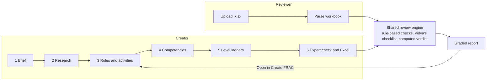
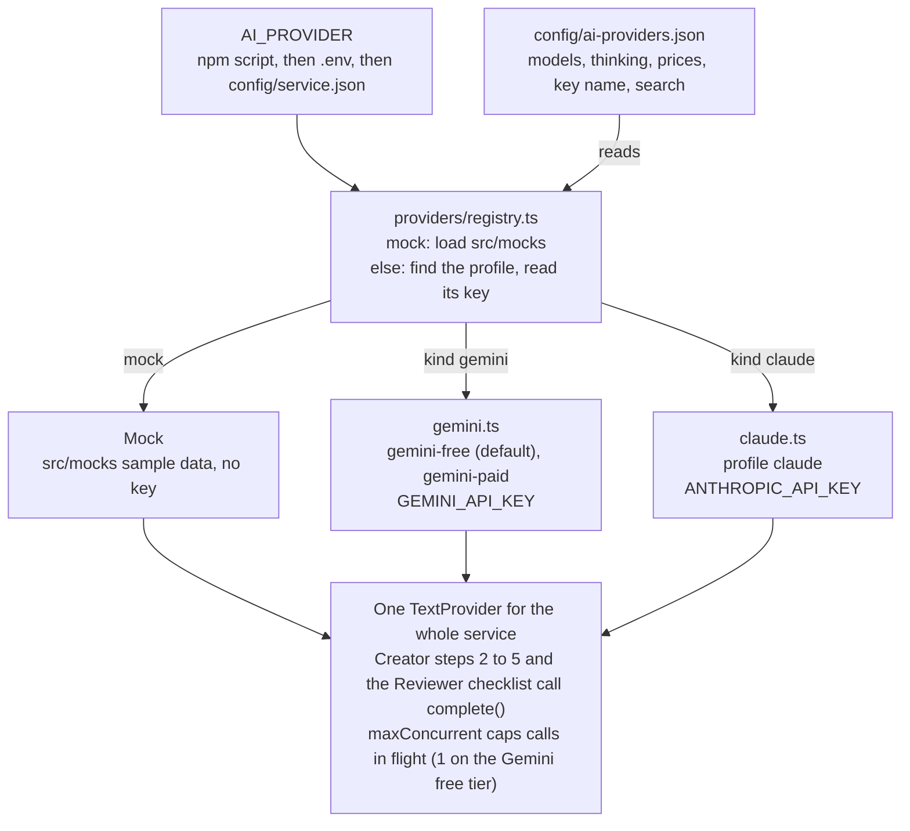

# FRAC Studio: how each step works

Last updated 6 Nov 2026. Shared copy: [FRAC Studio: how each step works](https://claude.ai/artifact/2QTqv1vRuoL81VdeQf5nmp). Keep the two in step.

## Overview

FRAC Studio builds and reviews FRAC competency dictionaries (Functions, Roles, Activities, Competencies) for Indian frontline health cadres such as ANM, ASHA, CHO and nurses. It has two tabs: the **Creator** builds a FRAC in six steps, and the **Reviewer** grades an existing FRAC workbook.

- **Where it runs:** the orgportal page `/app/home/frac-studio` calls the uiproxy at `/apis/protected/v8/fracStudio/*`, which forwards to frac-studio-service (Node, Postgres). The proxy sets the signed-in user's identity; the service never trusts an id from the browser.
- **Who does the AI work:** two AI personas inside the prompts, not people and not separate services. **Kaushal** is a FRAC and HR architect who writes research, roles, activities, competencies and ladders. **Vidya** checks clinical and programme accuracy for Indian frontline health, and answers the review checklist.
- **Model:** whichever provider `AI_PROVIDER` names: Gemini free tier by default, Gemini paid, Claude, or the sample-data mock. Research, roles, competencies and the review run on the complex tier at high thinking; activities and ladders on the default tier at medium. See "AI providers" below.
- **With `AI_PROVIDER=mock`** (`npm run dev:mock`) the service uses a mock that returns sample content shaped exactly like the real answers, so the whole flow can be tested before go-live. The UI marks its costs as estimates.
- **Long steps run as jobs:** the page starts a job, polls it, and shows progress, AI calls, tokens and cost.

The Creator's expert check and the Reviewer's upload both run the same rule-based checks and Vidya checklist, so a FRAC built here is graded exactly like one uploaded from outside.

## Step 1: Brief

The team says what to build: cadre, state, size and an optional scope note. No AI runs at this step.

| Field | Rule |
| --- | --- |
| Cadre | Required, up to 200 characters (e.g. ANM) |
| State | Optional; blank means the national baseline |
| Size | Compact, standard (default) or full; sets the targets below |
| Scope note | Optional free text passed to every later prompt |

| Size | Roles | Activities per role | Competencies |
| --- | --- | --- | --- |
| Compact | 6–8 (target 7) | 4–6 (target 5) | 16–22 (target 18) |
| Standard | 10–14 (target 12) | 5–8 (target 6) | 28–40 (target 32) |
| Full | 15–19 (target 17) | 6–9 (target 7) | 45–60 (target 50) |

**Behaviour:** the brief can be edited until research exists. After that, any change to cadre, state, size or scope is refused with `BRIEF_LOCKED` (HTTP 409), because every later step was written for that brief. To change it, start a new FRAC.

## Step 2: Research

Kaushal researches the job in one AI call, or the team fills in the Research tab by hand. Either way the result is the evidence every later step builds on.

**What the AI does:** reads the brief and, in production, searches the web, limited to `nhm.gov.in`, `mohfw.gov.in`, `igotkarmayogi.gov.in` and `cbc.gov.in` (up to 5 searches). It returns the full cadre name, a code prefix, the postings, a summary, sources, what the cadre is and is not authorised to do, the state context, assumptions and items to verify.

**What the service does with the answer:**

- Code prefix: upper-case letters only, at most 4 (e.g. `ANM`); falls back to `C`.
- Postings: at most 3, renamed P1, P2, P3. If the AI gives none, one posting named after the cadre.
- Lists (authorised, not authorised, state context) are saved as one item per line.
- Every "verify" item is added to the assumptions with the prefix `VERIFY:` so the team sees what needs checking.

**Behaviour:** research can run with no earlier step. It locks the brief (Step 1). Running it again with feedback revises it, keeps the team's later edits, and saves a new version.

## Step 3: Roles and activities

Kaushal drafts the roles, then writes the activities for each role. It needs research (or an imported FRAC) first; otherwise the service refuses with `STEP_NOT_READY`.

1. **Roles:** one high-effort call returns the target number of roles for the size, each with a title and source.
2. **Activities:** medium-effort calls, 4 roles per call, 3 calls at once. Each activity carries its text, the postings it applies to (P1–P3), a source and a source tier (JD, programme guideline, facility standard, or "Inferred – verify"). Progress shows "x of y roles".
3. **Codes:** roles are renumbered R1…Rn and activities A1…An, numbered across all roles, not per role.

**Behaviour on a revise:**

- Activities the team typed in (source "Added by team") are kept under the role with the same title.
- Every activity's competency mapping is cleared, and the expert check result is cleared.
- Existing competencies are **kept**, and the FRAC is marked "roles changed". The page then offers "Re-derive competencies" or "Mapping checked". Hand edits to roles after competencies exist set the same flag.

## Step 4: Competencies

Kaushal derives the competencies from the activities in one high-effort call, and maps every activity to one competency at one level. It needs at least one role with activities.

**Each competency has:** a code (the FRAC's prefix plus a number, e.g. ANM7), a label, a description, a type (Domain, Functional or Behavioural), an area and an optional KCM tag.

**What the service does with the answer:**

- Each activity's mapping is written as `competency@level`, e.g. `ANM7@L3`.
- A mapping that names a competency not in the answer fails the step with `AI_OUTPUT_INVALID`; nothing is saved.
- A competency whose code and label are both unchanged keeps its ladder. Any other competency gets its ladder cleared, so Step 5 writes it fresh.
- The "roles changed" flag and the expert check result are cleared.

**Behaviour on a revise:** codes already used are passed to the AI, so new competencies are numbered after the highest existing one and old codes are not reused for different things.

## Step 5: Level ladders

Kaushal writes five levels (L1–L5) for each competency, and Vidya checks each clinical fact inside the same call. It needs at least one competency.

- **Batches:** medium-effort calls, 4 competencies per call, 3 calls at once. Every batch is saved as soon as it returns, so a failure part-way keeps the ladders already written. Progress shows "x of y competencies".
- **Shape check:** each ladder must have exactly 5 levels, each with a label and a description; any other shape fails with `AI_OUTPUT_INVALID`. Ladders returned for a competency that wasn't asked for are ignored.
- **What gets written:**

| Action | Competencies it rewrites |
| --- | --- |
| Write level ladders (the next-step button) | Only those with no ladder yet |
| Rewrite all, with feedback | Every competency |
| Revise {code}, on one card | That one competency |
| Fix these competencies, on an expert check finding | The competencies the finding cites, with the finding as feedback |

The team can also write or edit a ladder by hand on its card; hand edits autosave.

## Step 6: Expert check and download

**Expert check:** runs the same review engine as the Reviewer tab (next section) on the FRAC being built, with the note "Generated in FRAC Studio. Be strict." It needs at least one competency, or it is refused with `NO_COMPETENCIES`. The result is saved on the FRAC, a version is saved as "Expert check", and the check also appears in My FRACs. Edits made while it runs are kept.

**Findings:** each finding shows its severity, what was found, the fix, and whether it came from a rule-based check or AI judgement. A finding that cites competencies of this FRAC offers "Fix these competencies" (Step 5).

**Download Excel:** the workbook has these sheets:

| Sheet | Holds |
| --- | --- |
| FRAC | Roles, activities, postings, sources and the competency@level mapping |
| Competencies | Each competency with type, area and its L1–L5 ladder |
| Method & Sources | How the FRAC was built and the research sources |
| Expert check | The findings, when a check has run (no agent names, only "Rule-based check" or "AI judgement (quoted)") |

## Reviewer: grading an uploaded FRAC

The Reviewer grades an Excel FRAC in three stages: rule-based checks in code, then Vidya's fixed AI checklist, then a verdict computed in code. The rules follow review engine r3 (`FRAC_Reviewer_rules_r3.md`).

**1. Upload and parse.** The team uploads an .xlsx (up to 15 MB) with optional cadre, state and notes. The parser:

- Reads every competency sheet (headers like "Level 1", "Applicable level" or "Theme 1"), including KCM-format sheets that list themes instead of a level ladder.
- Reads the Role–Activity sheet, including the single "Roles/Activities" column layout, and notes whether a competency mapping column exists.
- Finds a "Position:" cell in the first 12 rows to infer the cadre when none is given.
- Works out the cadre family: ASHA, ANM, CHO or nurse (all frontline), or none.

**2. Rule-based checks** (the same answer on every run):

| Check | What it flags |
| --- | --- |
| Bloom's verbs | Level labels that don't start with a measurable verb ("knowledge of", "has knowledge", "understands"); laddered competencies only |
| FRAC structure | No Role–Activity sheet; activities written as syllabus outcomes; untyped competencies; no Behavioural or Functional ones; thin roles; competencies too broad; KCM-like names on Domain competencies |
| Level ladder | Incomplete ladders; KCM-format competencies with no job ladder; the same generic L5 repeated; the same label on two levels; ladders shifted upward |
| Scope (ANM, ASHA) | Acts beyond the cadre's authorised scope, checked sentence by sentence against the rule tables |
| Guidelines & context | Outdated laws, programmes and terms (e.g. NDPS 1965, RNTCP, TT vaccine, VHND, partograph without LCG) |
| Coverage | No activity–competency mapping; core cadre areas with no competency |

**3. Vidya's AI checklist.** Six competencies per call, three calls at once, each answering two fixed questions: Q1, is any act beyond the cadre's scope? Q2, is any clinical or programme fact wrong? A third call (Q3) asks how the FRAC fits the named state, in five categories, at most 6 items; it is skipped for a national review. Every AI flag must quote at least 4 words that appear in that competency's text. Code then drops a flag when the quote isn't found, or the rule-based checks already cover it. What remains becomes at most 3 findings with fixed titles: "Other acts beyond {cadre} scope" (Blocker), "Clinical or programme facts to correct" (Major), and "Does not reflect {state}" (minor).

**4. Verdict (computed, never written by the AI):**

| Triage | When |
| --- | --- |
| Rebuild from the job | Activities read as syllabus outcomes, no competency is typed, or more than half the ladders are incomplete |
| Revise | Any Blocker, or 3 or more Majors |
| Use with minor edits | Everything else |

Findings are sorted by severity, then check, with rule-based findings before AI ones.

**Same file, same review.** Each review is stored with a fingerprint of the file's content, the context and the rule tables. Uploading the same file with the same context shows the saved review straight away, with a note and a "Run a fresh review" link. Editing the rule tables (`config/review-rules.json`, `config/outdated.json`) changes the fingerprint, so old reviews are never reused under new rules.

## Jobs, progress, cost and tokens

Every AI step, expert check and review runs as a job on the server; the page polls it and the work continues if the page is closed.

- **Progress panel:** while running it shows the step, the personas working, "x of y done", elapsed time, AI calls, tokens in and out, and the cost so far. When finished, one line keeps the time, calls, tokens and cost of the step.
- **Cost:** priced at the active provider's list prices (see "Pricing" below); on the Gemini free tier and the mock it is an estimate, marked est. Each call's spend is recorded even when its answer is rejected, and each finished job logs one "Job spend" line on the server.
- **"est."** before a cost means it is an estimate: the mock's guessed tokens, or a free-tier call priced at paid list prices. On a paid key the figure is the real cost.

**Measured on the mock (ANM, Bihar, research through expert check):**

| Size | AI calls | Input tokens | Output tokens | Estimated cost |
| --- | --- | --- | --- | --- |
| Compact | 14 | 22,122 | 7,735 | $0.12 |
| Standard | 21 | 35,858 | 13,546 | $0.21 |
| Full | 23 | 40,887 | 15,756 | $0.24 |

A Reviewer upload of the sample ANM workbook took 5 calls and about $0.03. These are a lower bound: real calls add thinking tokens, web searches and the final prompt text. The first runs with a real key will give the real figures.

**Errors a job can end with:**

| Code | Meaning |
| --- | --- |
| `AI_OUTPUT_INVALID` | The answer didn't have the expected shape; nothing from that call is saved |
| `AI_REFUSED` | The model declined; rephrase the brief or feedback |
| `AI_OUTPUT_TRUNCATED` | The answer was cut off; try a smaller size or fewer competencies |
| `JOB_INTERRUPTED` | The service restarted mid-step; run the step again |

Calls retry up to 3 times on network and rate-limit errors, with a 10-minute timeout each. Other job errors from the provider: `AI_AUTH` (key rejected), `AI_BUSY` (quota or rate limit), `AI_REQUEST_REJECTED`, `AI_UNAVAILABLE`.

## Saving, history and access

- **Autosave:** hand edits save 1.4 seconds after typing stops; the sidebar shows "Saving…", "All changes saved" or a retry. The next-step button waits until edits are saved, because steps read the saved FRAC.
- **Edits during a running step are kept:** a step's result is merged into the latest saved FRAC, not the copy it started from.
- **History:** every AI step, revise and expert check saves a version ("Level ladders (revised)", "Expert check"). Restoring a version first saves the current state as "Before restore", so a restore can be undone.
- **Ownership:** each user sees only their own FRACs and reviews; the user comes from the proxy, never from the request body.

| Role | Can |
| --- | --- |
| `frac_admin` | Everything: create, run steps, edit, check, review, download |
| `frac_read` | See everything and download; every button that changes a FRAC is hidden |

Both roles are in the portal's bootstrap role list, so a user with only one of them is not logged out.

## Conditions verified

The service's automated suite passes: 138 tests passed and 3 skipped (the 3 need real workbooks or a real key). The portal's 3,581 Jest tests and its production build pass. One service test, reading a workbook with a sheet named History, fails now and then and is being looked at.

| Area | What is checked | Result |
| --- | --- | --- |
| Whole Creator flow (mock) | Brief → research → roles → competencies → ladders → expert check → Excel → re-import; at most 3 postings, global A-codes, every activity mapped, every competency used, 5 levels each, spend recorded | Pass |
| Step rules | Brief locks after research; steps refused until the previous one exists; edits kept during a step; roles revise keeps competencies and flags them | Pass |
| Review rules r3 | 14 rule tests plus 18 check tests: parser layouts, KCM sheets, scope sentence by sentence, outdated terms, ladder shifts, coverage areas | Pass |
| AI checklist | Quotes under 4 words or not in the text are dropped; flags already covered by a rule are dropped; at most 3 fixed-title findings | Pass |
| Verdict and report | Sort order, triage thresholds, computed verdict, summary and strengths | Pass |
| Same file, same review | Second upload returns the saved review (HTTP 200, no job); rerun starts a new job | Pass (tests and a manual run) |
| Cost | Rates by tier, cache reads and writes, web search fee; parallel batches record every call | Pass (tests and 5 repeat runs) |
| Providers | Profiles load and are validated; a missing key or unknown provider stops startup; Gemini usage and error mapping; at most `maxConcurrent` calls in flight | Pass (tests; no real Gemini call yet) |
| API and Postgres | All routes, identity required, upload limits, migrations applied twice | Pass |
| Real data | The entity-service competency master (129 competencies) reviewed as ANM, Bihar: revise, 7 Blockers, 11 Majors, 7 minors; C37 and ME70 flagged as the rules expect | Matches |

**Still open:**

- [ ] Meghalaya ANM, Bihar ANM and GNM workbooks from Sarvesh, for the r3 acceptance tests
- [ ] Exact METHOD and SOURCE\_LIBRARY prompt text from `frac-studio.html`
- [ ] Clinical team answers: ME68 operative-procedure flags on define/assist indicators; "planning" read as a KCM name; ASHA scope "instead" texts marked (verify)
- [ ] First runs with a real key (Gemini free first, then Claude): real cost per step, repeatability, the acceptance tests
- [ ] View-only user walkthrough in the app, then one deploy after full testing

## Running it: mock, Gemini or Claude

One service, three ways to run it. Run every command in `~/SonarRepos/frac-studio-service`. The portal's dev proxy sends `/apis/protected/v8/fracStudio` to port 3010 (`PORT=3010` in `.env`), so run one server at a time.

| To run | Key in `.env` | Commands |
| --- | --- | --- |
| Mock (sample data) | none | `npm run dev:mock` |
| Mock with a finished FRAC and review preloaded | none | `npm run dev:mock:seed` (memory store) |
| Gemini free tier (the default) | `GEMINI_API_KEY` | `npm run ai:check`, then `npm run dev:ai` |
| Gemini paid tier | `GEMINI_API_KEY` on a billed project | `AI_PROVIDER=gemini-paid npm run dev:ai` |
| Claude | `ANTHROPIC_API_KEY` | `AI_PROVIDER=claude npm run ai:check`, then `AI_PROVIDER=claude npm run dev:ai` |
| A built server (`dist/`) | as above | `npm run start:mock` or `npm run start:ai` |

- **One review, analysed:** `npm run review:report -- <id>` explains a Reviewer upload (review id) or a FRAC's expert checks (FRAC id): the verdict and the rule that set the triage, each check, every finding (severity, rule-based or AI, competencies cited), what the AI checklist raised, kept and dropped, and the cost call by call.
- **One server run:** `npm run ai:report:run` reports a single run of the service, from start to stop (or now), with totals, cost per step and every call. `npm run ai:report -- --frac <id>` costs one FRAC's complete flow. Every report keeps only Claude calls by default (`REPORT_PROVIDERS`); add `-- --provider all` to include Gemini and the mock.
- **Every call, as it happens:** the server log prints "AI call started" and "AI call finished" for each call (job, task, provider, model, time, tokens, cost, outcome). `npm run ai:report:daily` writes one day's report listing every call with its start and finish time (IST), plus tokens, cost, wall time and thinking share per step, the comparison with the day before, cost per FRAC, what revisions added, cost per user, and a warning when a day's billed spend passes `REPORT_DAILY_BUDGET_USD` ($5 by default; estimates do not count).
- **See how the AI answered:** `npm run ai:report` writes `reports/ai-report-<date>.md` from the per-call log: answered-OK rate, wrong-shape and failed calls, time, tokens and cost per provider and task, and how many review flags were kept or dropped. Release notes are in `RELEASE_NOTES/` (template, tracker of updates and blockers).
- **Make sure a run uses the AI, not the mock:**

    1. Start it with `npm run dev:ai` (or `start:ai`). These set `AI_REQUIRE_REAL=true`, so the service refuses to start on the mock and says why. `npm run dev` does not: it follows whatever `AI_PROVIDER` says.
    2. The startup log names the provider: `"ai":"gemini-free"` (or `claude`), never `"ai":"mock"`.
    3. `curl -H 'x-aastrika-creator: me' localhost:3010/v1/info` returns `{"aiProvider":"gemini-free"}`.
    4. After a step, `npm run ai:report -- --days 1` lists the calls under `gemini-free · gemini-3.6-flash`; mock calls show as `mock · mock`.

    The cost in the portal reads "est." on both the mock and the Gemini free tier (no bill either way), so it does not tell them apart; the checks above do.
- **Check a key before a full run:** `npm run ai:check` makes one tiny call per tier and prints the model, tokens and cost, or the error (`AI_AUTH` for a bad key, `AI_BUSY` for a used-up quota, `AI_UNAVAILABLE` with HTTP 503/504 when Google is overloaded). Verified on 6 Nov 2026 with the team's free-tier key on `gemini-3.6-flash`.
- **Change the default:** set `AI_PROVIDER=<profile>` in `.env` instead of prefixing each command.
- **Which one is answering:** the startup log line shows `"ai":"gemini-free"` (or `mock`, `claude`), and `GET /v1/info` returns the same.
- **A missing key stops startup** with the variable to set and a pointer to `npm run dev:mock`.
- **The portal:** start orgportal with `npm run start:mdo-dev` and open `/app/home/frac-studio`. Nothing in the portal changes between providers.
- **Postgres:** the default store; `.env` holds the `POSTGRES_*` connection. `FRAC_STUDIO_STORE=memory` runs without a database (data is lost on restart).

## AI providers

`AI_PROVIDER` names a profile in `config/ai-providers.json`, or `mock`; the service builds one provider at startup and every AI step calls it. The steps, prompts, checks, batching and the portal are the same for all of them.

A profile holds everything that differs between providers, so switching needs no code change:

| Profile | Models (complex / default tier) | Thinking | Web search for research | Calls at once | Key |
| --- | --- | --- | --- | --- | --- |
| `gemini-free` (default) | `gemini-3.6-flash` / `gemini-3.6-flash` | high / medium | No (not on the free tier) | 1 | `GEMINI_API_KEY` |
| `gemini-paid` | `gemini-4-argon` / `gemini-3.8-flash` | high / medium | Google Search; the 4 government sites are asked for, not enforced | batch settings | `GEMINI_API_KEY` |
| `claude` | `claude-sonnet-5-5` / `claude-sonnet-5-5` | high / medium (Claude effort) | Web search limited to the 4 government sites | batch settings | `ANTHROPIC_API_KEY` |
| `mock` | none: `src/mocks/content/cadres.json` | none | Fixed sample sources | batch settings | none |

**Switch provider:** set `AI_PROVIDER` (in `.env`, or in front of the command) and that profile's key, then restart. **Change a model or price:** edit the profile and restart. **Add a provider** (for example OpenAI):

1. Write `src/providers/text/<kind>.ts` implementing `TextProvider` (copy `gemini.ts`: send the prompt, pull the JSON with `extractJson`, report usage, map errors to the `AI_*` codes).
2. Add it to `FACTORIES` in `src/providers/registry.ts` and to `PROVIDER_KINDS` in `src/config/ai-providers.ts`.
3. Add a profile with its models, thinking, prices and `keyEnv`, then run `npm run config:check` and `npm run ai:check`.

**Why `gemini-free` runs `gemini-3.6-flash`:** on 6 Nov 2026 `gemini-3.8-flash` answered 503 ("high demand") and 504 (timeout) while `gemini-3.6-flash` and `gemini-3.5-flash` answered at once. Both Flash models have the same free-tier terms and paid list price. To move back, set both `models` of the profile to `gemini-3.8-flash` and run `npm run ai:check`.

**When a job fails with `AI_UNAVAILABLE`:** the message names the model and Google's HTTP status. 503 or 504 means Google is overloaded, not that the key is wrong: try again later or switch the profile's model. A bad key shows `AI_AUTH`; a used-up quota shows `AI_BUSY`.

**Answers in the wrong shape:** on Claude, ladders, roles, competencies and the review checklist use structured output, so the answer is always valid JSON of the step's shape. Research (web search) and activities (free-key postings) are read as text by a tolerant reader. Any answer that is still unreadable or the wrong shape is asked again once (`LLM_INVALID_RETRIES`, each attempt billed and logged with the reason) before the step fails with `AI_OUTPUT_INVALID`. Ladders already written are kept, so "Write level ladders" only redoes the missing ones.

**Cost savers:** a repeat expert check reuses the stored checklist answer for every competency whose text did not change (`REVIEW_REUSE_ANSWERS`, `migrations/008_review_answer_cache.sql`), so a check after "Fix these competencies" costs only the changed batch and, if the FRAC changed, the state-fit call. "Run a fresh review" still asks everything. The `claude-mixed` profile runs activities and ladders on Haiku 5.5 at about a twentieth of Sonnet's price: four ANM ladders cost $0.004 against about $0.04, with no blockers, but Haiku kept a clinical slip already in the ladder (MgSO4 "for pre-eclampsia"), so compare quality with the expert check before choosing it.

**Speed:** steps run one after another, and a call takes about as long as its output (mostly thinking). Ladders, activities and the review checklist run 6 calls at once; research runs at most 3 searches. The `claude-fast` profile (same model, medium / low thinking) is faster and cheaper; compare it with `claude` on the same FRAC using `npm run ai:report` before choosing it.

**How the Gemini provider behaves:** JSON output mode whenever search is off, `thinkingLevel` per tier, and retries on 408/429/5xx that wait 5 s first, then longer, up to 60 s (`LLM_MAX_RETRY_DELAY_MS`). A bad key, a used-up quota, an unknown model, a refusal and a cut-off answer map to the same job errors as Claude: `AI_AUTH`, `AI_BUSY`, `AI_REQUEST_REJECTED`, `AI_REFUSED`, `AI_OUTPUT_TRUNCATED`.

## Pricing

The Gemini free tier and the mock bill nothing. Gemini paid costs about the same as Claude on the complex tier and about a third as much on the default tier. Prices are USD list prices per million tokens, checked on 6 Nov 2026, and stored per profile in `config/ai-providers.json`.

| Profile | Complex tier in / out | Default tier in / out | Cached input | Web search | Billed? |
| --- | --- | --- | --- | --- | --- |
| `mock` | – | – | – | – | No; shows an estimate at `MOCK_PRICED_AS` prices (default `gemini-free`) |
| `gemini-free` | $0.75 / $3.75 (`gemini-3.6-flash`) | $0.75 / $3.75 | $0.075 | not available | No; shows what the paid tier would cost, marked est. |
| `gemini-paid` | $2 / $10 (`gemini-4-argon`) | $0.75 / $3.75 (`gemini-3.8-flash`) | $0.10 / $0.075 | $14 per 1,000 searches after 5,000 free a month | Yes |
| `claude` | $2 / $10 (`claude-sonnet-5-5`) | $2 / $10 | $0.20 reads; writes at 1.25 x input | $10 per 1,000 searches | Yes |

- **How a call is priced:** uncached input x the input price, cached input at its own price, output (thinking included) x the output price, plus the per-search fee. Every call's spend is added to its job, even when the answer is rejected.
- **What the portal shows:** each job line reads "12.4k tokens in · 3.1k out · $0.04", with "est." in front of the dollar figure on the mock and the free tier.
- **The mock understates:** it estimates tokens from text length and counts no thinking, so a real run costs more than the mock shows.
- **Prices due to change:** `gemini-4-argon` on 1 Dec 2026 and other Gemini models on 1 Jan 2027. Edit the `rates` in the profile when they do; no code change.
- **Measured on `ai:check` (6 Nov 2026):** one tiny call on `gemini-3.6-flash` used 39 tokens in and 114–157 out (mostly thinking), est. $0.0005–0.0006 at paid prices. Thinking tokens dominate small calls.
- **Free-tier limits:** 20 requests a day per model per project (Google's `GenerateRequestsPerDayPerProjectPerModel-FreeTier`, checked 6 Nov 2026), reset at midnight Pacific, and one call at a time. A standard FRAC needs about 21 calls and a compact one about 14, so a standard FRAC cannot finish in one day on one free model. A used-up quota fails the job with `AI_BUSY`.
- **Measured cost of one standard FRAC (6 Nov 2026, ANM, Arunachal Pradesh, 12 roles, 72 activities, 32 competencies, `gemini-3.6-flash`):**

    | Step | Calls | Tokens in / out | Cost at paid list price |
    | --- | --- | --- | --- |
    | Research | 1 | 1,445 / 3,434 | $0.014 |
    | Roles and activities | 4 | 7,149 / 13,322 | $0.055 |
    | Competencies | 1 | 3,349 / 12,525 | $0.050 |
    | Level ladders | 8 | 17,000 / 33,200 (7 measured, 1 estimated) | $0.137 |
    | Expert check | 7 | about 27,600 / 18,000 (estimated) | about $0.09 |
    | **Whole FRAC** | **21** | **about 56,500 / 80,500** | **about $0.35** ($0 billed on the free tier) |

    **Measured on Claude (6 Nov 2026, same FRAC size):** $0.84 for research → expert check, 21 calls, 184,130 tokens: research $0.13, roles and activities $0.13, competencies $0.11, ladders $0.31, expert check $0.16.

    Output tokens are mostly thinking. On the same token counts the `gemini-paid` profile would cost about $0.61 and `claude` about $0.92; those models think differently, so measure before relying on it.
- **Cost per FRAC is not measured yet.** The first compact FRAC on `gemini-free` gives the real token counts per step; until then any per-FRAC figure is a guess.

Sources: [Gemini API pricing](https://aistudio.google.com/docs/pricing); Claude prices as recorded in the service on 4 Nov 2026.

## Configuration

Every tunable sits in a committed file under `config/`; secrets sit only in `.env` or the secret store. An environment variable of the same name overrides `config/service.json`. Everything is read at startup, so restart after a change, except the review rule tables and the method paragraph, which are re-read on every review or export.

| File | What it sets | Checked by |
| --- | --- | --- |
| `config/service.json` | `AI_PROVIDER`, `MOCK_PRICED_AS`, call limits, batching, review checklist limits, research search, jobs, Postgres pool, request limits, CORS, logging | `npm run config:check` (unknown keys, non-numbers, secrets, unknown provider) |
| `config/ai-providers.json` | One profile per provider: `kind`, `keyEnv`, `models`, `thinking`, `rates`, `webSearch`, `freeTier`, `maxConcurrent` | Startup and `config:check`; a bad profile stops startup naming the field |
| `config/frac-sizes.json` | Roles, activities per role and competencies for compact, standard and full | Startup |
| `config/review-rules.json`, `config/outdated.json` | The rule-based check tables (scope, ladder, outdated terms) | Each review; a change also changes the review fingerprint |
| `config/method.txt` | The method paragraph in the Excel export | Each export |
| `.env` (not committed) | `GEMINI_API_KEY`, `ANTHROPIC_API_KEY`, `POSTGRES_*`, `PORT`, local overrides such as `AI_PROVIDER` | Startup refuses any `*_API_KEY` in a `config/` file |

The settings people change most:

| Setting | Default | What it does |
| --- | --- | --- |
| `AI_PROVIDER` | `gemini-free` | Which profile answers, or `mock` |
| `LLM_TIMEOUT_MS` / `LLM_RETRIES` / `LLM_MAX_RETRY_DELAY_MS` | 10 min / 3 / 60 s | Per-call timeout, retries, longest wait between retries |
| `LLM_MAX_TOKENS` | 64,000 | Longest answer one call may write, thinking included |
| `AI_BATCH_SIZE` / `AI_BATCH_PARALLEL` | 4 / 3 | Roles or competencies per call, calls at once (activities, ladders) |
| `REVIEW_BATCH_SIZE` / `REVIEW_BATCH_PARALLEL` | 6 / 3 | Competencies per checklist call, calls at once |
| `RESEARCH_WEB_SEARCH` / `RESEARCH_SEARCH_DOMAINS` | on / 4 government sites | Off switch and site list for research search |
| `MOCK_DELAY_MS` / `MOCK_PRICED_AS` | 1,500 / `gemini-free` | Mock pause per call; whose prices the mock estimate uses |
| `JOB_STALE_AFTER_MS` / `JOB_HEARTBEAT_MS` | 15 min / 1 min | When a silent job counts as interrupted; how often a running job reports in |

What stays in code on purpose: rules the spec fixes, such as at most 3 postings, 5 levels per ladder, the finding titles and the triage thresholds.

## Where the code is

Two repos: the service holds the logic, AI and storage; the portal holds the screens. the service's `docs/CODEBASE_GUIDE.md` explains every file.

| Repo and path | What lives there |
| --- | --- |
| [frac-AIstudio-service](https://github.com/vpPavithra/frac-AIstudio-service), branch `feat/frac-studio-workbook-export` | The backend (Node, Express, TypeScript, Postgres) |
| `src/providers/` | The AI seam: `registry.ts`, and `text/` with `gemini.ts`, `claude.ts`, `pricing.ts`, `limit.ts`, `json.ts` |
| `src/services/ai/` | Creator steps 2 to 5: prompts, batching, output schemas |
| `src/services/review-engine/` | Rule-based checks, fingerprint, report |
| `src/services/ai-review.service.ts` | Vidya's checklist (Q1 scope, Q2 accuracy, Q3 state fit) |
| `src/services/excel/` | Workbook reader and writer |
| `src/services/queue/` | Job runner, progress and spend per job |
| `src/mocks/` | The sample-data provider; deletable without a code change |
| `src/scripts/` | `config:check`, `ai:check` |
| orgportal, branch `feat/frac-studio`, `project/ws/app/src/lib/routes/frac-studio/` | The Creator, Reviewer and My FRACs screens; `services/frac-studio-api.service.ts` calls the service through the uiproxy |

**Repo docs:** `README.md` (run, switch provider, tuning), `docs/CODEBASE_GUIDE.md` (every file, request and job flow, known gaps), `docs/ARCHITECTURE.md` (layers and spec gaps), `src/mocks/README.md` (mock vs real provider), `docs/spec/R3_GAP_ANALYSIS.md` (review engine r3 status), and orgportal's `FRAC_STUDIO_BUILD_TRACKER.html` (build status and the pre-deploy checklist).
