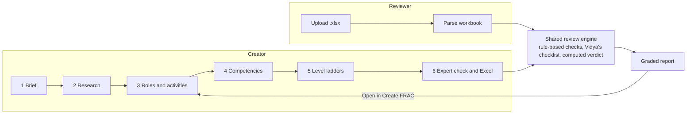
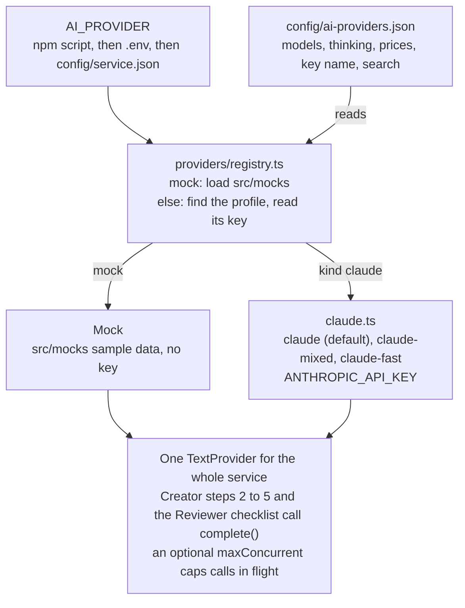

# FRAC Studio: how each step works

Last updated 11 Nov 2026 (review decisions added; Claude is the only real provider). Shared copy: [FRAC Studio: how each step works](https://claude.ai/artifact/2QTqv1vRuoL81VdeQf5nmp). Keep the two in step.

## Overview

FRAC Studio builds and reviews FRAC competency dictionaries (Functions, Roles, Activities, Competencies) for Indian frontline health cadres such as ANM, ASHA, CHO and nurses. It has two tabs: the **Creator** builds a FRAC in six steps, and the **Reviewer** grades an existing FRAC workbook.

- **Where it runs:** the orgportal page `/app/home/frac-studio` calls the uiproxy at `/apis/protected/v8/fracStudio/*`, which forwards to frac-studio-service (Node, Postgres). The proxy sets the signed-in user's identity; the service never trusts an id from the browser.
- **Who does the AI work:** two AI personas inside the prompts, not people and not separate services. **Kaushal** is a FRAC and HR architect who writes research, roles, activities, competencies and ladders. **Vidya** checks clinical and programme accuracy for Indian frontline health, and answers the review checklist. Since the Nov 2026 review the portal shows neither name: users see "Agent" ("The agent is writing…"); the names stay only inside the prompts.
- **What a team can give instead of the AI (Nov 2026):** a job description or government order for research, standard Roles, Competencies and Sources sheets (each with a template), and a matched position whose postings and roles are reused. Each one skips or shortens an AI step; see "Documents, templates and position matching" below and `docs/COST_IMPACT_REVIEW_DECISIONS.md`.
- **Model:** whichever profile `AI_PROVIDER` names: `claude` (Claude Sonnet 5.5) by default, `claude-mixed`, `claude-fast`, or the sample-data mock. Research, roles, competencies and the review run on the complex tier at high thinking; activities and ladders on the default tier at medium. See "AI providers" below.
- **With `AI_PROVIDER=mock`** (`npm run dev:mock`) the service uses a mock that returns sample content shaped exactly like the real answers, so the whole flow can be tested before go-live. The UI marks its costs as estimates.
- **Long steps run as jobs:** the page starts a job, polls it, and shows progress, AI calls, tokens and cost.

The Creator's expert check and the Reviewer's upload both run the same rule-based checks and Vidya checklist, so a FRAC built here is graded exactly like one uploaded from outside.

## Step 1: Brief

The team says what to build: the position, the state and an optional scope note, and may attach a job description or government order. No AI runs at this step. (The portal says "Position" where older screens said "Cadre"; the API field is still `cadre`.)

| Field | Rule |
| --- | --- |
| Position (`cadre`) | Required, up to 200 characters (e.g. ANM). Matched exactly against existing positions as it is typed (see "Position matching" below) |
| State | Optional; blank means the national baseline |
| Size | No longer asked. The research step chooses compact, standard or full from the breadth of the job and gives a one-line reason (`sizeBy: "agent"`, `sizeReason`). An API caller that still sends `size` keeps it (`sizeBy: "team"`) |
| Scope note | Optional free text passed to every later prompt |
| Documents | Optional, up to 3 (PDF, DOCX, TXT); uploaded once the FRAC exists. See "Documents, templates and position matching" |

| Size | Roles | Activities per role | Competencies |
| --- | --- | --- | --- |
| Compact | 6–8 (target 7) | 4–6 (target 5) | 16–22 (target 18) |
| Standard | 10–14 (target 12) | 5–8 (target 6) | 28–40 (target 32) |
| Full | 15–19 (target 17) | 6–9 (target 7) | 45–60 (target 50) |

**Behaviour:** the brief can be edited until research exists. After that, any change to the position, state, size or scope, or a new brief document, is refused with `BRIEF_LOCKED` (HTTP 409), because every later step was written for that brief. To change it, start a new FRAC.

## Step 2: Research

Kaushal researches the job in one AI call, or the team fills in the Research tab by hand. Either way the result is the evidence every later step builds on.

**What the AI does:** reads the brief and, in production, searches the web, limited to `nhm.gov.in`, `mohfw.gov.in`, `igotkarmayogi.gov.in` and `cbc.gov.in` (up to 3 searches). It returns the full position name, a code prefix, the postings, a summary, sources, what the position is and is not authorised to do, the state context, assumptions and items to verify, and, when the brief left the size to the agent, the size and why.

**What the team can give it (Nov 2026):**

- **Attached documents:** their text (at most 30,000 characters in total) goes into the prompt as the primary source, and the search drops to 1.
- **A standard Sources sheet:** research uses those sources, does not search, and leaves the sources out of its answer.
- **Postings from a Roles sheet or a matched position:** research is told they are fixed and keeps them.

**What the service does with the answer:**

- Code prefix: upper-case letters only, at most 4 (e.g. `ANM`); falls back to `C`.
- Postings: every place of work the brief and documents name, renamed P1, P2, P3…: one, several or none. With none, the Research tab stays empty for the team to add them; the team's own postings are kept on a re-run (review, 12–13 Nov 2026).
- Lists (authorised, not authorised, state context) are saved as one item per line.
- Every "verify" item is added to the assumptions with the prefix `VERIFY:` so the team sees what needs checking.
- **Source links (View Source):** the prompt tells the agent to open the JD and the main guidelines with Claude's web search before listing them, and to give each source the address of the page it opened. A link is kept only when it is real: a page the search returned whose title matches the source title by more than 60% (`SOURCE_LINK_MIN_MATCH`; a weaker match is ignored, so the row shows no link), or an address on the research domains or on `SOURCE_LINK_DOMAINS` (sites that host guidelines such as IPHS, Dakshata or the WHO Labour Care Guide but are not searched) that answers a quick check. Anything else is dropped. In the Research tab the View icon on each source row opens the page or document; a source with no link shows the icon greyed out, and hovering, tapping or tabbing to it says why: a source without a link is drawn from several documents, so there is no single link to view; your uploaded job description is a file, not a web page. The Excel has a URL column.
- **Size:** when the agent chooses, a valid `size` in the answer is saved with its reason; anything else keeps "standard".

**Behaviour:** research can run with no earlier step. It locks the brief (Step 1). Running it again with feedback revises it, keeps the team's later edits, and saves a new version.

## Step 3: Roles and activities

Kaushal drafts the roles, then writes the activities for each role. It needs research (or an imported FRAC) first; otherwise the service refuses with `STEP_NOT_READY`.

**Roles from a standard sheet or a matched position (Nov 2026):** the roles are kept as they are. Only roles with no activities get them written (the activity calls alone, no roles call). With every role filled, the step makes no AI call. The main button reads "Write missing activities". "Revise with feedback" still rebuilds the roles with the AI.

**Roles tab (13 Nov 2026):** roles and activities are built by the agent. The tab has no upload box, re-apply or roles check; a Roles sheet uploaded earlier still works on that FRAC. The quick checks at the top show its Bloom's verbs and FRAC structure findings. (`POST /v1/fracs/:id/roles/verify` stays in the service but the portal no longer offers it.)

**Fixing expert-check findings (13 Nov 2026):** "Fix these competencies" and "Fix all findings" rewrite level ladders, so they show only for findings about ladder text (Bloom's verbs, the ladder shape, scope quoted from a level). An outdated name gets **Replace with … (no AI)**, which swaps it everywhere the check reads it (names, descriptions, ladders, activities). Missing competencies, types and state fit are fixed by hand on their tab. After an upload or edit leaves a step out of date, the footer follows the tab you are updating, as the first build did: on Research, Competencies, Roles & activities or Level ladders it offers **Re-run …** for that tab's own step, with its rough cost; on Expert check or History it offers **Open … to re-run it** for the earliest out-of-date step (no AI call until you are there).

**Quick checks (13 Nov 2026):** the Roles, Competencies and Level ladders tabs show the expert check's Bloom's verbs and FRAC structure findings for that tab at the top, re-run after every upload, step and save (rules only, no AI, no cost). Each roles and competency sheet also lists the rule findings about its rows under the sheet at upload. When quick-check issues are still open, a line next to "Run expert check" says so. The expert check still runs every rule and the AI checklist.

**Flow changes (13 Nov 2026, after testing):**
- **Competency sheet first:** it uploads on the Research tab, under the Sources sheet. The tabs and the progress tracker run Research, Competencies, Roles & activities, Level ladders, Expert check: the sheet's competencies show right after research, and a step counts as done only once it is reached. The roles job then maps each new activity to them (one mapping call at the end), so there is no separate mapping click. Without a sheet, competencies are derived after Roles & activities, as before.
- **Roles are built by the agent:** the Roles tab has no upload box and no roles check. A Roles sheet uploaded earlier still works on that FRAC.
- **Fix all on the expert check:** one button rewrites the ladders of every competency the open findings name, in one run (about $0.011 per competency), then the check shows out of date. Findings that name only activities, roles or missing areas are listed under it for a hand fix.
- **Create FRAC form:** the job description box has no "Download template" link; the Research tab keeps it.

1. **Roles:** one high-effort call returns the target number of roles for the size, each with a title and source.
2. **Activities:** medium-effort calls, 4 roles per call, 3 calls at once. Each activity carries its text, the postings it applies to (P1, P2…), a source and a source tier (JD, programme guideline, facility standard, or "Inferred – verify"). Progress shows "x of y roles".
3. **Codes:** roles are renumbered R1…Rn and activities A1…An, numbered across all roles, not per role.

**Behaviour on a revise:**

- Activities the team typed in (source "Added by team") are kept under the role with the same title.
- Every activity's competency mapping is cleared, and the expert check result is cleared.
- Existing competencies are **kept**, and the FRAC is marked "roles changed". The page then offers "Re-derive competencies" or "Mapping checked". Hand edits to roles after competencies exist set the same flag.

## Step 4: Competencies

Kaushal derives the competencies from the activities in one high-effort call, and maps every activity to one competency at one level. It needs at least one role with activities.

**Each competency has:** a code (the FRAC's prefix plus a number, e.g. ANM7), a label, a description, a type (Domain, Functional or Behavioural), an area and an optional KCM tag.

**What the service does with the answer:**

- Each activity's mapping is written as `competency@level`, e.g. `ANM7@L3`.
- A mapping that names a competency not in the answer fails the step with `AI_OUTPUT_INVALID`; nothing is saved.
- A competency whose code and label are both unchanged keeps its ladder. Any other competency gets its ladder cleared, so Step 5 writes it fresh.
- The "roles changed" flag and the expert check result are cleared.

**Behaviour on a revise:** codes already used are passed to the AI, so new competencies are numbered after the highest existing one and old codes are not reused for different things.

**With a standard Competencies sheet (Nov 2026):** the competencies are kept as uploaded. One small default-tier `mapping` call only maps each activity to one of them at a level. The main button reads "Map activities to your competencies". Competencies whose five levels came in the sheet keep their ladder.

## Step 5: Level ladders

Kaushal writes five levels (L1–L5) for each competency, and Vidya checks each clinical fact inside the same call. It needs at least one competency.

- **Batches:** medium-effort calls, 4 competencies per call, 3 calls at once. Every batch is saved as soon as it returns, so a failure part-way keeps the ladders already written. Progress shows "x of y competencies".
- **Shape check:** each ladder must have exactly 5 levels, each with a label and a description; any other shape fails with `AI_OUTPUT_INVALID`. Ladders returned for a competency that wasn't asked for are ignored.
- **What gets written:**

| Action | Competencies it rewrites |
| --- | --- |
| Write level ladders (the next-step button) | Only those with no ladder yet |
| Rewrite all, with feedback | Every competency |
| Revise {code}, on one card | That one competency |
| Fix these competencies, on an expert check finding | The competencies the finding cites, with the finding as feedback |

The team can also write or edit a ladder by hand on its card; hand edits autosave.

**Preview roles (Nov 2026):** once every activity is mapped to a competency, "Preview roles" on the Level ladders tab opens a read-only popup. It shows each role's activities with their posting Yes/No, the competency and level each maps to, and that level's label and indicators ("Ladder not written yet" where a ladder is missing). It needs no API or AI call.

## Step 6: Expert check and download

**Expert check:** runs the same review engine as the Reviewer tab (next section) on the FRAC being built, with the note "Generated in FRAC Studio. Be strict." It needs at least one competency, or it is refused with `NO_COMPETENCIES`. The result is saved on the FRAC, a version is saved as "Expert check", and the check also appears in My FRACs. Edits made while it runs are kept.

**After a fix or an edit:** "Fix these competencies", a ladder revise or a hand edit to research, postings, roles or competencies marks the check out of date (`reviewStale`). The old findings stay on screen with a note, the main button reads "Re-run expert check", and a download before the re-run is a draft (below), so the Excel never carries findings already fixed. A re-run reuses the stored checklist answer for every competency that did not change.

**Findings:** each finding shows its severity, what was found, the fix, and whether it came from a rule-based check or AI judgement. A finding that cites competencies of this FRAC offers "Fix these competencies" (Step 5). That rewrites ladders, so it fixes findings about level text (scope, accuracy, verbs, ladder shape); it cannot fix a finding about a competency's label ("too broadly defined") or about the whole FRAC ("Does not reflect {state}"). Rename the competency by hand, or add the state items to the research state context and revise the competencies.

**Download Excel:** available beside "Run expert check" as soon as competencies exist, so the team can open the Excel and confirm it before the check. Before a check, or after edits that put it out of date, the button reads "Download draft Excel"; that file has no "Expert check" sheet, and its "Built" row says "not yet expert-checked". After a clean check it reads "Download Excel" and includes the findings. The workbook has these sheets:

| Sheet | Holds |
| --- | --- |
| FRAC | Roles, activities, postings, sources and the competency@level mapping |
| Competencies | Each competency with type, area and its L1–L5 ladder |
| Method & Sources | How the FRAC was built and the research sources |
| Expert check | The findings, when a check has run and is not out of date (no agent names, only "Rule-based check" or "AI judgement (quoted)") |

## Documents, templates and position matching

Added after the FRAC Studio review of Nov 2026. What changed where: `docs/releases/REVIEW_DECISIONS_2026-11.md`. Cost effect: `docs/COST_IMPACT_REVIEW_DECISIONS.md`.

**Documents a team can attach** (`POST /v1/fracs/:id/documents`, multipart `file` and `kind`):

| Kind | Where in the portal | File | What happens |
| --- | --- | --- | --- |
| `brief` | Brief form, Research tab (before research) | PDF, DOCX, TXT; up to 3 | Text kept (30,000 characters each); research reads it first and searches once |
| `roles` | Roles tab | .xlsx, .csv | Replaces roles, activities and postings; the Roles step only fills empty roles |
| `competencies` | Competencies tab | .xlsx, .csv | Replaces competencies (with their ladders where all 5 levels are filled); the Competencies step only maps |
| `sources` | Research tab | .xlsx, .csv | Research uses these sources and does not search; replaces the sources now if research exists |

- **Safety:** a sheet upload saves a version first (History can undo it), and is refused while a step runs (`JOB_RUNNING`). A newer sheet of a kind replaces the older one.
- **Removing a sheet:** the content stays, and the step goes back to the AI.
- **Errors:** `FILE_TYPE_NOT_ALLOWED`, `FILE_UNREADABLE` (including a scanned PDF with no text), `SHEET_NOT_RECOGNISED` (with a pointer to the template), `TOO_MANY_DOCUMENTS`, `BRIEF_LOCKED`.
- **Storage:** the uploaded file is never stored. Only the extracted text or the import summary goes into `frac_documents`; for sources, the rows too.

**Templates** (`GET /v1/templates/:kind`, "Download template" on every slot): an .xlsx for `roles`, `competencies` and `sources`, each with an example and an "Instructions" sheet, plus a text guide for `brief` documents. The sheet layouts are the Creator's own Excel download, so a downloaded FRAC can be uploaded as it is.

**Position matching** (the brief form, as the position is typed):

1. `GET /v1/fracs/match?cadre=&state=` looks for the user's own FRAC with exactly this position name that has roles (case and spaces ignored; the same state first).
2. If there is none, the portal checks the FRAC module's Positions master (entity API) for a position with exactly that name and reads its roles and activities.
3. **On a match:** a ticked card offers to start from it, and `POST /v1/fracs` gets a `seed`:
   - from an earlier FRAC: its postings and roles (competency mappings cleared);
   - from Positions: its roles and activity texts.
   The FRAC records `seededFrom`. Research keeps the seeded postings; the roles step needs no AI call, or only fills empty roles.
4. **No match:** "A new position will be created with this FRAC", and the team carries on.

Earlier-FRAC matching covers only the user's own FRACs: FRACs carry no organisation yet.

## Reviewer: grading an uploaded FRAC

The Reviewer grades an Excel FRAC in three stages: rule-based checks in code, then Vidya's fixed AI checklist, then a verdict computed in code. The rules follow review engine r3 (`FRAC_Reviewer_rules_r3.md`).

**1. Upload and parse.** The team uploads an .xlsx (up to 15 MB) with optional cadre, state and notes. The parser:

- Reads every competency sheet (headers like "Level 1", "Applicable level" or "Theme 1"), including KCM-format sheets that list themes instead of a level ladder.
- Reads the Role–Activity sheet, including the single "Roles/Activities" column layout, and notes whether a competency mapping column exists.
- Finds a "Position:" cell in the first 12 rows to infer the cadre when none is given.
- Works out the cadre family: ASHA, ANM, CHO or nurse (all frontline), or none.

**2. Rule-based checks** (the same answer on every run):

| Check | What it flags |
| --- | --- |
| Bloom's verbs | Level labels that don't start with a measurable verb ("knowledge of", "has knowledge", "understands"); laddered competencies only |
| FRAC structure | No Role–Activity sheet; activities written as syllabus outcomes; untyped competencies; no Behavioural or Functional ones; thin roles; competencies too broad; KCM-like names on Domain competencies |
| Level ladder | Incomplete ladders; KCM-format competencies with no job ladder; the same generic L5 repeated; the same label on two levels; ladders shifted upward |
| Scope (ANM, ASHA) | Acts beyond the cadre's authorised scope, checked sentence by sentence against the rule tables |
| Guidelines & context | Outdated laws, programmes and terms (e.g. NDPS 1965, RNTCP, TT vaccine, VHND, partograph without LCG) |
| Coverage | No activity–competency mapping; core cadre areas with no competency |

**3. Vidya's AI checklist.** Six competencies per call, three calls at once, each answering two fixed questions: Q1, is any act beyond the cadre's scope? Q2, is any clinical or programme fact wrong? A third call (Q3) asks how the FRAC fits the named state, in five categories, at most 6 items; it is skipped for a national review. Every AI flag must quote at least 4 words that appear in that competency's text. Code then drops a flag when the quote isn't found, or the rule-based checks already cover it. What remains becomes at most 3 findings with fixed titles: "Other acts beyond {cadre} scope" (Blocker), "Clinical or programme facts to correct" (Major), and "Does not reflect {state}" (minor).

**4. Verdict (computed, never written by the AI):**

| Triage | When |
| --- | --- |
| Rebuild from the job | Activities read as syllabus outcomes, no competency is typed, or more than half the ladders are incomplete |
| Revise | Any Blocker, or 3 or more Majors |
| Use with minor edits | Everything else |

Findings are sorted by severity, then check, with rule-based findings before AI ones.

**Same file, same review.** Each review is stored with a fingerprint of the file's content, the context and the rule tables. Uploading the same file with the same context shows the saved review straight away, with a note and a "Run a fresh review" link. Editing the rule tables (`config/review-rules.json`, `config/outdated.json`) changes the fingerprint, so old reviews are never reused under new rules.

## Jobs, progress, cost and tokens

Every AI step, expert check and review runs as a job on the server; the page polls it and the work continues if the page is closed.

- **One job per FRAC:** while a step or check runs, starting another on the same FRAC (a second tab, a reload, a quick second click) answers `JOB_RUNNING` and the page follows the running job instead. After a reload the progress panel comes back by itself. A job that stops reporting for two heartbeats (2 minutes) is taken as dead, marked `JOB_INTERRUPTED`, and the new step starts.
- **Spending limit:** a job stops with `AI_BUDGET_EXCEEDED` once its billed spend reaches `JOB_MAX_COST_USD` ($3). The call that crossed it is recorded and finished batches stay saved. Mock estimates never count.
- **Progress panel:** while running it shows the step, the personas working, "x of y done", elapsed time, AI calls, tokens in and out, and the cost so far. When finished, one line keeps the time, calls, tokens and cost of the step.
- **Cost:** priced at the active provider's list prices (see "Pricing" below); on the mock it is an estimate, marked est. Each call's spend is recorded even when its answer is rejected, and each finished job logs one "Job spend" line on the server.
- **"est."** before a cost means it is an estimate: the mock's guessed tokens priced at `MOCK_PRICED_AS`. On a real key the figure is the real cost.

**Measured on the mock (ANM, Bihar, research through expert check):**

| Size | AI calls | Input tokens | Output tokens | Estimated cost |
| --- | --- | --- | --- | --- |
| Compact | 14 | 22,122 | 7,735 | $0.12 |
| Standard | 21 | 35,858 | 13,546 | $0.21 |
| Full | 23 | 40,887 | 15,756 | $0.24 |

A Reviewer upload of the sample ANM workbook took 5 calls and about $0.03. These are a lower bound: real calls add thinking tokens, web searches and the final prompt text. Real runs on Claude Sonnet 5.5 cost $0.84–0.96 per standard FRAC (see "Conditions verified" and "Pricing").

**Errors a job can end with:**

| Code | Meaning |
| --- | --- |
| `AI_OUTPUT_INVALID` | The answer didn't have the expected shape; nothing from that call is saved |
| `AI_REFUSED` | The model declined; rephrase the brief or feedback |
| `AI_OUTPUT_TRUNCATED` | The answer was cut off; try a smaller size or fewer competencies |
| `JOB_INTERRUPTED` | The service restarted mid-step, or the step went silent; run the step again |
| `AI_BUDGET_EXCEEDED` | The step reached its spending limit; finished parts are saved, run it again to continue |

Refused before a job starts: `JOB_RUNNING` (a step or check is already running on this FRAC; the page follows it), `STEP_NOT_READY`, `BRIEF_LOCKED`, `NO_COMPETENCIES`.

Calls retry up to 3 times on network and rate-limit errors, with a 10-minute timeout each. Other job errors from the provider: `AI_AUTH` (key rejected), `AI_BUSY` (quota or rate limit), `AI_REQUEST_REJECTED`, `AI_UNAVAILABLE`.

## Saving, history and access

- **Autosave:** hand edits save 1.4 seconds after typing stops; the sidebar shows "Saving…", "All changes saved" or a retry. The next-step button waits until edits are saved, because steps read the saved FRAC.
- **Edits during a running step are kept:** a step's result is merged into the latest saved FRAC, not the copy it started from.
- **History:** every AI step, revise and expert check saves a version ("Level ladders (revised)", "Expert check"). Restoring a version first saves the current state as "Before restore", so a restore can be undone.
- **Ownership:** each user sees only their own FRACs and reviews; the user comes from the proxy, never from the request body.

| Role | Can |
| --- | --- |
| `frac_admin` | Everything: create, run steps, edit, check, review, download |
| `frac_read` | See everything and download; every button that changes a FRAC is hidden |

Both roles are in the portal's bootstrap role list, so a user with only one of them is not logged out.

## Conditions verified

The service's automated suite passes: 168 tests passed and 3 skipped (the 3 need real workbooks or a real key), and an HTTP walkthrough of every endpoint on the mock passes 38 of 38 checks (9 Nov). The portal's 3,581 Jest tests and its production build pass. One service test, reading a workbook with a sheet named History, fails now and then and is being looked at.

| Area | What is checked | Result |
| --- | --- | --- |
| Whole Creator flow (mock) | Brief → research → roles → competencies → ladders → expert check → Excel → re-import; postings only as named, global A-codes, every activity mapped, every competency used, 5 levels each, spend recorded | Pass |
| Step rules | Brief locks after research; steps refused until the previous one exists; edits kept during a step; roles revise keeps competencies and flags them; one running job per FRAC; a fix or edit marks the expert check out of date; the spending limit stops a job | Pass |
| Review rules r3 | Rule and check tests: parser layouts, KCM sheets, scope sentence by sentence (sentences that rule an act out are not flagged), outdated terms, "family / birth planning" not a KCM name, ladder shifts, coverage areas | Pass |
| AI checklist | Quotes under 4 words or not in the text are dropped; flags already covered by a rule are dropped; at most 3 fixed-title findings | Pass |
| Verdict and report | Sort order, triage thresholds, computed verdict, summary and strengths | Pass |
| Same file, same review | Second upload returns the saved review (HTTP 200, no job); rerun starts a new job | Pass (tests and a manual run) |
| Cost | Rates by tier, cache reads and writes, web search fee; parallel batches record every call | Pass (tests and 5 repeat runs) |
| Providers | Profiles load and are validated; a missing key or unknown provider stops startup; Claude usage and error mapping; at most `maxConcurrent` calls in flight | Pass (tests and real runs) |
| Real AI runs | Three complete FRACs on Claude Sonnet 5.5 (ANM Arunachal $0.84, Staff Nurse Karnataka $0.86, ASHA Karnataka $0.96 first pass), expert checks and a Reviewer upload | Pass; reports in `reports/` |
| API and Postgres | All routes, identity required, upload limits, migrations 001–009 applied twice | Pass |
| Real data | The entity-service competency master (129 competencies) reviewed as ANM, Bihar: revise, 7 Blockers, 11 Majors, 7 minors; C37 and ME70 flagged as the rules expect | Matches |

**Still open:**

- [ ] Meghalaya ANM, Bihar ANM and GNM workbooks from Sarvesh, for the r3 acceptance tests
- [ ] Exact METHOD and SOURCE\_LIBRARY prompt text from `frac-studio.html`
- [ ] Clinical team answers: ME68 operative-procedure flags on define/assist indicators; ASHA scope "instead" texts marked (verify); scope lists for Staff Nurse, GNM and CHO ("planning" fixed 9 Nov)
- [x] First runs with a real key: three FRACs on Claude, cost per step in `reports/fracs/`
- [ ] "Fix these competencies" for label and state findings (proposed: route each finding to the step that can fix it)
- [ ] Quality comparison before switching to `claude-mixed` or lower effort (about $5)
- [ ] View-only user walkthrough in the app, then one deploy after full testing

## Running it: mock or Claude

One service, two ways to run it: the sample-data mock or Claude. Run every command in `~/SonarRepos/frac-studio-service`. The portal's dev proxy sends `/apis/protected/v8/fracStudio` to port 3010 (`PORT=3010` in `.env`), so run one server at a time.

| To run | Key in `.env` | Commands |
| --- | --- | --- |
| Mock (sample data) | none | `npm run dev:mock` |
| Mock with a finished FRAC and review preloaded | none | `npm run dev:mock:seed` (memory store) |
| Claude (the default, `claude`) | `ANTHROPIC_API_KEY` | `npm run ai:check`, then `npm run dev:ai` |
| Another Claude profile | `ANTHROPIC_API_KEY` | `AI_PROVIDER=claude-mixed npm run dev:ai` (or `claude-fast`) |
| A built server (`dist/`) | as above | `npm run start:mock` or `npm run start:ai` |

- **One review, analysed:** `npm run review:report -- <id>` explains a Reviewer upload (review id) or a FRAC's expert checks (FRAC id): the verdict and the rule that set the triage, each check, every finding (severity, rule-based or AI, competencies cited), what the AI checklist raised, kept and dropped, and the cost call by call.
- **One server run:** `npm run ai:report:run` reports a single run of the service, from start to stop (or now), with totals, cost per step and every call. `npm run ai:report -- --frac <id>` costs one FRAC's complete flow. Every report keeps only Claude calls by default (`REPORT_PROVIDERS`); add `-- --provider all` to include the mock.
- **Every call, as it happens:** the server log prints "AI call started" and "AI call finished" for each call (job, task, provider, model, time, tokens, cost, outcome). `npm run ai:report:daily` writes one day's report listing every call with its start and finish time (IST), plus tokens, cost, wall time and thinking share per step, the comparison with the day before, cost per FRAC, what revisions added, cost per user, and a warning when a day's billed spend passes `REPORT_DAILY_BUDGET_USD` ($5 by default; estimates do not count).
- **See how the AI answered:** `npm run ai:report` writes `reports/ai-report-<date>.md` from the per-call log: answered-OK rate, wrong-shape and failed calls, time, tokens and cost per provider and task, and how many review flags were kept or dropped. Release notes, the AI service tracker and build reports are in `docs/releases/`.
- **Make sure a run uses the AI, not the mock:**

    1. Start it with `npm run dev:ai` (or `start:ai`). These set `AI_REQUIRE_REAL=true`, so the service refuses to start on the mock and says why. `npm run dev` does not: it follows whatever `AI_PROVIDER` says.
    2. The startup log names the provider: `"ai":"claude"` (or the profile in use), never `"ai":"mock"`.
    3. `curl -H 'x-aastrika-creator: me' localhost:3010/v1/info` returns `{"aiProvider":"claude"}`.
    4. After a step, `npm run ai:report -- --days 1` lists the calls under `claude · claude-sonnet-5-5`; mock calls show as `mock · mock`.

    The cost in the portal reads "est." on the mock (no bill), so check one of the above to be sure.
- **Check a key before a full run:** `npm run ai:check` makes one tiny call per tier and prints the model, tokens and cost, or the error (`AI_AUTH` for a bad key, `AI_BUSY` for a rate limit, `AI_UNAVAILABLE` with the HTTP status when the provider is overloaded).
- **Change the default:** set `AI_PROVIDER=<profile>` in `.env` instead of prefixing each command.
- **Which one is answering:** the startup log line shows `"ai":"claude"` (or `mock`, `claude-mixed`, `claude-fast`), and `GET /v1/info` returns the same.
- **A missing key stops startup** with the variable to set and a pointer to `npm run dev:mock`.
- **The portal:** start orgportal with `npm run start:mdo-dev` and open `/app/home/frac-studio`. Nothing in the portal changes between providers.
- **Postgres:** the default store; `.env` holds the `POSTGRES_*` connection. `FRAC_STUDIO_STORE=memory` runs without a database (data is lost on restart). To look at the stored data in pgAdmin 4, see `docs/DATABASE.md`.

## AI providers

`AI_PROVIDER` names a profile in `config/ai-providers.json`, or `mock`; the service builds one provider at startup and every AI step calls it. The steps, prompts, checks, batching and the portal are the same for all of them.

A profile holds everything that differs between providers, so switching needs no code change:

| Profile | Models (complex / default tier) | Thinking | Web search for research | Calls at once | Key |
| --- | --- | --- | --- | --- | --- |
| `claude` (default) | `claude-sonnet-5-5` / `claude-sonnet-5-5` | high / medium (Claude effort) | Web search limited to the 4 government sites | batch settings | `ANTHROPIC_API_KEY` |
| `claude-mixed` | `claude-sonnet-5-5` / `claude-haiku-5-5` | high / medium | As `claude` | batch settings | `ANTHROPIC_API_KEY` |
| `claude-fast` | `claude-sonnet-5-5` / `claude-sonnet-5-5` | medium / low | As `claude` | batch settings | `ANTHROPIC_API_KEY` |
| `mock` | none: `src/mocks/content/cadres.json` | none | Fixed sample sources | batch settings | none |

**Switch provider:** set `AI_PROVIDER` (in `.env`, or in front of the command) and that profile's key, then restart. **Change a model or price:** edit the profile and restart. **Add a provider** (for example OpenAI):

1. Write `src/providers/text/<kind>.ts` implementing `TextProvider` (copy `claude.ts`: send the prompt, pull the JSON with `extractJson`, report usage, map errors to the `AI_*` codes).
2. Add it to `FACTORIES` in `src/providers/registry.ts` and to `PROVIDER_KINDS` in `src/config/ai-providers.ts`.
3. Add a profile with its models, thinking, prices and `keyEnv`, then run `npm run config:check` and `npm run ai:check`.

**When a job fails with `AI_UNAVAILABLE`:** the message names the model and the provider's HTTP status. 503 or 504 means the provider is overloaded, not that the key is wrong: try again later or switch the profile's model. A bad key shows `AI_AUTH`; a rate limit shows `AI_BUSY`.

**Answers in the wrong shape:** on Claude, ladders, roles, competencies and the review checklist use structured output, so the answer is always valid JSON of the step's shape. Research (web search) and activities (free-key postings) are read as text by a tolerant reader. Any answer that is still unreadable or the wrong shape is asked again once (`LLM_INVALID_RETRIES`, each attempt billed and logged with the reason) before the step fails with `AI_OUTPUT_INVALID`. Ladders already written are kept, so "Write level ladders" only redoes the missing ones.

**Cost savers:** a repeat expert check reuses the stored checklist answer for every competency whose text did not change (`REVIEW_REUSE_ANSWERS`, `migrations/008_review_answer_cache.sql`), so a check after "Fix these competencies" costs only the changed batch and, if the FRAC changed, the state-fit call. "Run a fresh review" still asks everything. The `claude-mixed` profile runs activities and ladders on Haiku 5.5 at about a twentieth of Sonnet's price: four ANM ladders cost $0.004 against about $0.04, with no blockers, but Haiku kept a clinical slip already in the ladder (MgSO4 "for pre-eclampsia"), so compare quality with the expert check before choosing it.

**Speed:** steps run one after another, and a call takes about as long as its output (mostly thinking). Ladders, activities and the review checklist run 6 calls at once; research runs at most 3 searches. The `claude-fast` profile (same model, medium / low thinking) is faster and cheaper; compare it with `claude` on the same FRAC using `npm run ai:report` before choosing it.

**Research web search is Claude only:** Claude's `web_search` tool, limited to `RESEARCH_SEARCH_DOMAINS` and at most `RESEARCH_SEARCH_MAX_USES` searches. The prompt tells the agent to search for the JD and the main guidelines before listing them (earlier runs sometimes searched 0 times).

**Gemini was removed on 11 Nov 2026** (provider file, profiles, SDK and `GEMINI_API_KEY`). Every real profile is Claude.

## Pricing

The mock bills nothing. Every real profile is Claude. Prices are USD list prices per million tokens, as recorded in `config/ai-providers.json` (Sonnet 5.5 checked 4 Nov 2026, Haiku 5.5 on 6 Nov 2026).

| Profile | Complex tier in / out | Default tier in / out | Cached input | Web search | Billed? |
| --- | --- | --- | --- | --- | --- |
| `mock` | – | – | – | – | No; shows an estimate at `MOCK_PRICED_AS` prices (default `claude`) |
| `claude` | $2 / $10 (`claude-sonnet-5-5`) | $2 / $10 | $0.20 reads; writes at 1.25 x input | $10 per 1,000 searches | Yes |
| `claude-mixed` | $2 / $10 (`claude-sonnet-5-5`) | $0.10 / $0.50 (`claude-haiku-5-5`, prompts up to 100K tokens; its tokenizer counts about 30% more tokens) | $0.20 / $0.01 | $10 per 1,000 searches | Yes |
| `claude-fast` | $2 / $10 (`claude-sonnet-5-5`) | $2 / $10 | $0.20 reads; writes at 1.25 x input | $10 per 1,000 searches | Yes |

- **How a call is priced:** uncached input x the input price, cached input at its own price, output (thinking included) x the output price, plus the per-search fee. Every call's spend is added to its job, even when the answer is rejected.
- **What the portal shows:** each job line reads "12.4k tokens in · 3.1k out · $0.04", with "est." in front of the dollar figure on the mock.
- **The mock understates:** it estimates tokens from text length and counts no thinking, so a real run costs more than the mock shows.
- **Prices change:** edit the `rates` in the profile when they do; no code change.
- **Measured cost of one standard FRAC on Claude Sonnet 5.5 (research → expert check):** ANM Arunachal $0.84 (6 Nov, 21 calls: research $0.13, roles and activities $0.13, competencies $0.11, ladders $0.31, expert check $0.16); Staff Nurse Karnataka $0.86 (6 Nov); ASHA Karnataka $0.96 first pass (9 Nov: research searched the web, $0.19). Output tokens, mostly thinking, are about 70% of the cost. Per-FRAC reports: `reports/fracs/`.
- **Spending limit:** one job stops at `JOB_MAX_COST_USD` ($3) of billed spend; a standard FRAC's dearest step is about $0.40.

Source: Claude prices as recorded in the service (`config/ai-providers.json`) on 4 and 6 Nov 2026.

## Configuration

Every tunable sits in a committed file under `config/`; secrets sit only in `.env` or the secret store. An environment variable of the same name overrides `config/service.json`. Everything is read at startup, so restart after a change, except the review rule tables and the method paragraph, which are re-read on every review or export.

| File | What it sets | Checked by |
| --- | --- | --- |
| `config/service.json` | `AI_PROVIDER`, `MOCK_PRICED_AS`, call limits, batching, review checklist limits, research search, source links, jobs, Postgres pool, request limits, CORS, logging | `npm run config:check` (unknown keys, non-numbers, secrets, unknown provider) |
| `config/ai-providers.json` | One profile per provider: `kind`, `keyEnv`, `models`, `thinking`, `rates`, `webSearch`, and optionally `freeTier`, `maxConcurrent` | Startup and `config:check`; a bad profile stops startup naming the field |
| `config/frac-sizes.json` | Roles, activities per role and competencies for compact, standard and full | Startup |
| `config/review-rules.json`, `config/outdated.json` | The rule-based check tables (scope, ladder, outdated terms) | Each review; a change also changes the review fingerprint |
| `config/method.txt` | The method paragraph in the Excel export | Each export |
| `.env` (not committed) | `ANTHROPIC_API_KEY`, `POSTGRES_*`, `PORT`, local overrides such as `AI_PROVIDER` | Startup refuses any `*_API_KEY` in a `config/` file |

The settings people change most:

| Setting | Default | What it does |
| --- | --- | --- |
| `AI_PROVIDER` | `claude` | Which profile answers, or `mock` |
| `LLM_TIMEOUT_MS` / `LLM_RETRIES` / `LLM_MAX_RETRY_DELAY_MS` | 10 min / 3 / 60 s | Per-call timeout, retries, longest wait between retries |
| `LLM_MAX_TOKENS` | 64,000 | Longest answer one call may write, thinking included |
| `AI_BATCH_SIZE` / `AI_BATCH_PARALLEL` | 4 / 6 | Roles or competencies per call, calls at once (activities, ladders) |
| `REVIEW_BATCH_SIZE` / `REVIEW_BATCH_PARALLEL` | 6 / 6 | Competencies per checklist call, calls at once |
| `RESEARCH_WEB_SEARCH` / `RESEARCH_SEARCH_DOMAINS` | on / 4 government sites | Off switch and site list for research search (Claude's web search) |
| `SOURCE_LINK_DOMAINS` | `nhsrcindia.org`, `main.mohfw.gov.in`, `who.int`, `nhp.gov.in`, `nhsrc.gov.in` | Guideline sites that are not searched but whose addresses a source may keep, if they answer the check |
| `SOURCE_LINK_CHECK_TIMEOUT_MS` / `SOURCE_LINK_MAX_CHECKS` | 3,000 / 10 | How long one link check waits; link checks per research run (0 keeps only searched pages) |
| `SOURCE_LINK_MIN_MATCH` | 0.6 | How closely a searched page's title must match a source's title (shared words, 0 to 1) to become its link; at or below it the page is ignored |
| `MOCK_DELAY_MS` / `MOCK_PRICED_AS` | 1,500 / `claude` | Mock pause per call; whose prices the mock estimate uses |
| `JOB_STALE_AFTER_MS` / `JOB_HEARTBEAT_MS` | 15 min / 1 min | When a silent job counts as interrupted; how often a running job reports in |
| `JOB_MAX_COST_USD` | 3 | Billed spend at which one job stops with `AI_BUDGET_EXCEEDED` (0 = no limit) |
| `DOC_MAX_CHARS` / `DOC_MAX_BRIEF_FILES` | 30,000 / 3 | Characters kept from one attached document (and sent to research from all of them); documents per FRAC |
| `RESEARCH_SEARCH_MAX_USES_WITH_DOCS` | 1 | Web searches research runs when a document is attached (a Sources sheet turns search off) |

What stays in code on purpose: rules the spec fixes, such as 5 levels per ladder, the finding titles and the triage thresholds.

## Where the code is

Two repos: the service holds the logic, AI and storage; the portal holds the screens. the service's `docs/CODEBASE_GUIDE.md` explains every file.

| Repo and path | What lives there |
| --- | --- |
| [frac-AIstudio-service](https://github.com/vpPavithra/frac-AIstudio-service), branch `feat/frac-studio-workbook-export` | The backend (Node, Express, TypeScript, Postgres) |
| `src/providers/` | The AI seam: `registry.ts`, and `text/` with `claude.ts`, `pricing.ts`, `limit.ts`, `json.ts` |
| `src/services/ai/` | Creator steps 2 to 5: prompts, batching, output schemas |
| `src/services/review-engine/` | Rule-based checks, fingerprint, report |
| `src/services/ai-review.service.ts` | Vidya's checklist (Q1 scope, Q2 accuracy, Q3 state fit) |
| `src/services/excel/` | Workbook reader and writer, the CSV reader, the upload templates |
| `src/services/document.service.ts`, `src/services/documents/` | Attached documents: text extraction, the standard sheet importers and their layouts (review decisions, Nov 2026) |
| `src/services/queue/` | Job runner: progress, spend per job, one running job per FRAC, the spending limit |
| `src/mocks/` | The sample-data provider; deletable without a code change |
| `tools/` | Not part of the running service: `reports/` (ai:report, review:report), `ops/` (config:check, ai:check), `fixtures/` |
| orgportal, branch `feat/frac-studio`, `project/ws/app/src/lib/routes/frac-studio/` | The Creator, Reviewer and My FRACs screens; `services/frac-studio-api.service.ts` calls the service through the uiproxy |

**Repo docs:** `README.md` (run, switch provider, tuning), the service's `docs/CODEBASE_GUIDE.md` (every file, request and job flow, known gaps), the service's `docs/CODE_FLOW.md` (where the code starts and how each flow runs), the service's `docs/API_REFERENCE.md` (every endpoint and AI call), the service's `docs/DATABASE.md` (looking at the data in pgAdmin), the service's `docs/COST_IMPACT_REVIEW_DECISIONS.md` (what the Nov 2026 review decisions do to AI cost), `docs/releases/REVIEW_DECISIONS_2026-11.md` (what changed where), the service's `docs/ARCHITECTURE.md` (layers and spec gaps), `src/mocks/README.md` (mock vs real provider), `docs/spec/R3_GAP_ANALYSIS.md` (review engine r3 status), and orgportal's `FRAC_STUDIO_BUILD_TRACKER.html` (build status and the pre-deploy checklist).
